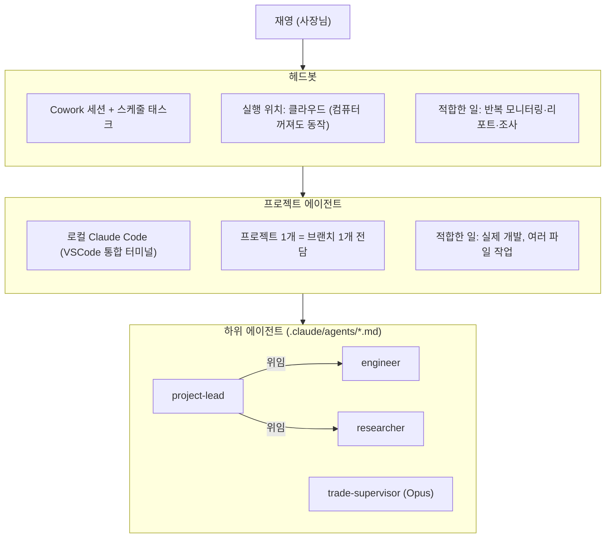

# AGENTS.md — 에이전트 조직 아키텍처

> 이 문서는 이 레포에서 "누가(어떤 에이전트가) 어디서(어떤 환경/브랜치) 어떻게(어떤 도구로) 일하는지"를 정의한다.
> 사람이 읽는 문화 문서(캐릭터, 톤)는 `랍스터주식회사/회사규칙.md`에 남겨두되, 실제 실행 구조는 이 문서를 기준으로 삼는다.

## 왜 다시 짰나

기존 `랍스터주식회사/` 구조는 두 가지 문제가 있었다.

1. **가짜 업무**: 각 페르소나(과장1/대리1/사원1/사원2/인사팀장) 매뉴얼이 "어느 Slack 채널에 어떤 톤으로 쓸지"만 정의하고, 실제로 파일을 만들거나 코드를 커밋하거나 스케줄을 등록하라는 지시가 없었다. 그 결과 spawn된 에이전트가 "[진행] 80% 완료" 같은 텍스트만 반복 생성하고 끝났다.
2. **지속 불가능한 실행 환경**: `slack_commander.py`는 사용자가 자기 컴퓨터에서 터미널을 계속 켜놔야만 동작하는 로컬 폴링 데몬이었다. 터미널을 닫으면 그냥 죽는다.

반대로 이미 실제로 동작하는 두 예시가 있었다:
- `competitive_intel_agent.py` + `.github/workflows/competitive_intel.yml` — GitHub Actions 크론으로 매일 실행, 실제 Apify/Naver 데이터 수집 → Claude 분석 → 이메일/구글시트까지 실제 산출물을 만듦.
- `automation/mvno-monitor/` — Cowork 스케줄 태스크로 매일 실행, 실제 웹서치 → 실제 Slack DM 발송.

이 문서가 정의하는 새 구조는 이 두 패턴을 표준으로 삼는다: **모든 에이전트는 반드시 실제 파일/코드/커밋/발송 같은 산출물을 남겨야 하고, Slack 메시지는 그 산출물에 대한 짧은 보고일 뿐이다.**

## 계층 구조

```
재영 (사장님)
  │
  ▼
헤드봇  ─────────────────────────────────────────
  │  이 대화(Cowork 세션) 자체 + Cowork 스케줄 태스크
  │  역할: 재영과 직접 소통, 우선순위 판단, 프로젝트 단위로 쪼개기
  │  실행 위치: 클라우드 (사용자 컴퓨터 안 켜져 있어도 동작)
  │  적합한 일: 반복 모니터링/리포트/조사, 짧은 대화형 작업
  │
  ▼
프로젝트 에이전트  ──────────────────────────────
  │  로컬 Claude Code (VSCode 통합 터미널에서 실행)
  │  역할: 프로젝트 작업 브랜치(`project/<이름표>-<할일>`)를 전담. 실제 코드/파일을 만들고 커밋
  │  실행 위치: 재영의 데스크탑 (VSCode 열려 있을 때)
  │  적합한 일: 실제 개발이 필요한 프로젝트, 여러 파일에 걸친 작업, 반복 실행되는 자동화 도구 자체를 "만드는" 작업
  │
  ▼
하위 에이전트  ──────────────────────────────────
     같은 Claude Code 세션 안에서 Task 도구로 spawn되는 서브에이전트
     정의 위치: `.claude/agents/*.md` (이 레포에 커밋됨)
     역할: 리서치/코딩/리뷰처럼 프로젝트 에이전트가 위임하는 하위 작업
```

<details>
<summary>Mermaid 버전 (GitHub/Obsidian에서 다이어그램으로 렌더링됨)</summary>



</details>

### 헤드봇 vs 프로젝트 에이전트, 언제 뭘 쓰나

| 판단 기준 | 헤드봇 (Cowork 스케줄 태스크) | 프로젝트 에이전트 (로컬 Claude Code) |
|---|---|---|
| 작업 성격 | 조사/모니터링/요약/발송 | 코드를 여러 파일에 걸쳐 작성·수정 |
| 실행 주기 | 정해진 시간에 반복 | 필요할 때 세션 단위로 |
| 사람 개입 | 거의 없음 (완전 자동) | VSCode를 열어야 시작됨 |
| 예시 | mvno-monitor, 경쟁사 인텔리전스 | 새 자동화 도구 개발, MVP 프로토타입, 리팩터링 |
| 결과물이 이미 도는 파이프라인을 "실행"하는 것 | ✅ | — |
| 결과물이 새 코드/새 파이프라인을 "만드는" 것 | — | ✅ |

애매하면: 일단 프로젝트 에이전트로 만들고, 완성돼서 반복 실행만 하면 되는 단계가 되면 헤드봇의 스케줄 태스크로 "졸업"시킨다. (mvno-monitor가 이 경로를 이미 밟았다.)

## 브랜치 전략 (GitHub Flow 간소화판)

> 상세 설명·근거·정리 루틴은 `.claude/skills/git-branch-policy/SKILL.md` 참고.

- `master` = 완성본. 실거래·배포 기계는 master(또는 태그)만 받는다. 사람과 프로젝트 에이전트는 master에 직접 커밋하지 않는다.
- 예외: 자동화 봇(github-actions[bot], 라즈베리파이 스케줄 태스크)은 자기 결과물 폴더(`research/`, `automation/mvno-monitor/` 로그 등)에 한해 master 직접 커밋 허용. 푸시 전 `git pull --rebase`. 봇이 코드를 고쳐야 하면 `bot/<봇이름>` 브랜치.
- 작업 브랜치 이름:
  - `project/<이름표>-<할일>` — 로컬 PC 개발 (예: `project/deepcoin-eth-slot`)
  - `claude/<자동이름>` — 클라우드 세션 자동 생성. 이름 바꾸지 않음. 최대 7일
  - `worktree-<이름>` — 로컬 `claude --worktree` 자동 생성. 종료 시 정리
  - `test/<MMDD>-<내용>` — 손 실험, 푸시 안 함, 2주 후 삭제
  - `archive/<YYYY-MM>-<내용>` — 보관용, 분기 1회 재검토
- 이름표: deepcoin, iching, mvno-monitor, cc-monitor, biz, infra
- 수명: 최신 master에서 만들고 → 매일 푸시 → 2주 안에 master로 머지 → **머지 즉시 로컬·원격 삭제(기본값)**.
- 한 브랜치 = 한 장소. 클라우드 세션 브랜치를 PC에서 이어갈 땐 `project/…`로 새 이름을 붙여 받아오고 원래 `claude/…`는 삭제.
- 커밋 메시지: `<이름표>: <무엇을> (<왜>)`, 한국어. 봇만 `chore: …`.
- 태그: 딥코인봇 실거래 반영 시 `deepcoin-live-YYYYMMDD` (annotated tag + push).
- 새 프로젝트 시작 = 새 브랜치 + `projects/<프로젝트명>/` 폴더 (아래 템플릿 참고) 생성.
- **index.lock 이슈(과거)**: 예전에 `.git/index.lock`이 낡은 채 남아 커밋/브랜치 생성이 막힌 적이 있다. 최근 커밋이 계속 들어가고 있어 해결됐을 가능성이 높지만 PC에서 확인하지 못했다. 확인 후 이 줄을 삭제하거나 "해결됨 YYYY-MM-DD"로 갱신할 것.

## 프로젝트 폴더 구조

```
projects/
  _template/          ← 새 프로젝트 시작할 때 복사해서 쓰는 템플릿
    CLAUDE.md          해당 프로젝트 전용 컨텍스트 (목표, 제약, 관련 링크)
    README.md
  <프로젝트명>/
    CLAUDE.md
    ...
```

기존에 흩어져 있던 `agents/`, `automation/`, `랍스터주식회사/`는 아직 그대로 둔다 (강제 이관 시 GitHub Actions 경로나 스케줄 태스크 경로가 깨질 수 있어서). 새 프로젝트부터 `projects/` 아래로 통일하고, 기존 것들은 여유 있을 때 하나씩 옮기는 걸 권장한다.

## 하위 에이전트 목록 및 모델 정책

| 에이전트 | 모델 | 역할 |
|---------|------|------|
| `trade-supervisor` | **Opus** | 딥코인봇 거래 품질 감독 — 타점/TP/SL 사후 검증, STRATEGY.md 개선 제안 |
| `project-lead` | Sonnet | 프로젝트 조율 및 하위 에이전트 위임 |
| `engineer` | Sonnet | 코드 구현/버그 수정/커밋 |
| `researcher` | Sonnet | 시장·기술 조사 및 결과 파일화 |

> **모델 원칙**: 감독/판단 역할 → Opus. 실행/개발 역할 → Sonnet. 비용 절감과 품질 균형.

## 하위 에이전트 사용 규칙

- `.claude/agents/*.md`에 정의된 서브에이전트만 사용한다 (이 레포에 커밋되어 있어 어떤 컴퓨터에서 Claude Code를 켜도 동일하게 동작).
- 모든 서브에이전트는 **"이 작업을 마치면 반드시 파일을 쓰거나 수정하거나 커밋한다"**를 기본 원칙으로 한다. Slack/텍스트 보고만 하고 끝나는 서브에이전트는 만들지 않는다.
- 보고는 산출물이 생긴 "다음"에, 무엇을 어디에 만들었는지(파일 경로, 커밋 해시, PR 링크) 한두 줄로 남긴다.

## Slack 사용 규칙 (개정)

기존 `랍스터주식회사/회사규칙.md`의 채널 구조(#랍스터본부, #실무팀, #성과보고, #인사팀장실)와 톤 규칙은 그대로 유효하다. 달라지는 건 하나: **메시지는 반드시 실제 산출물(커밋/파일/PR/발송 결과)이 생긴 뒤에만 올린다.** "착수합니다", "진행 중입니다" 류의 상태 메시지만 반복하는 건 금지.
